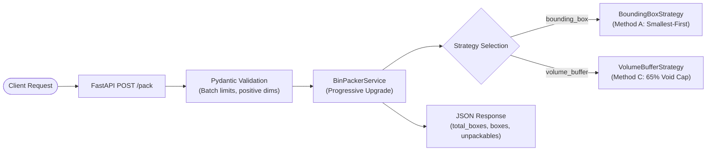
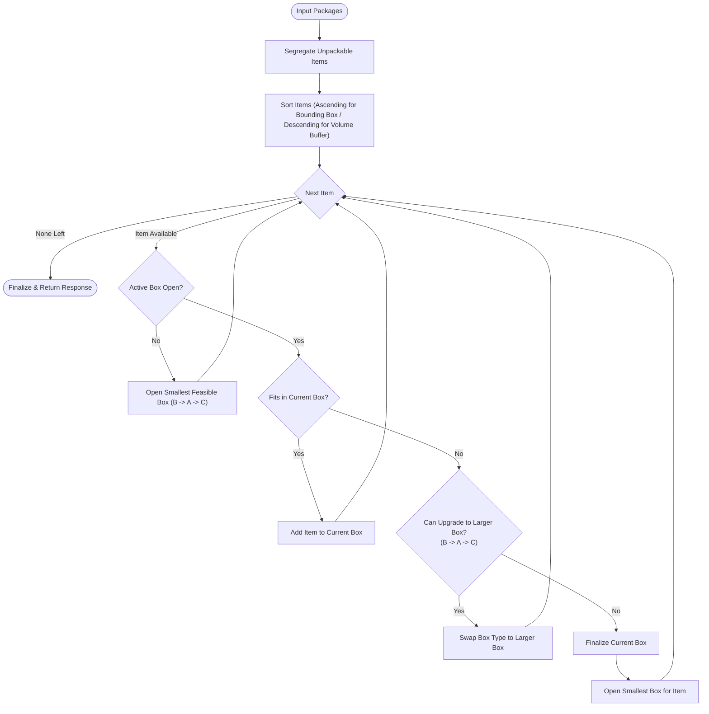

# Bin Packing HTTP Service

A production-ready FastAPI service that calculates the minimum number of shipping boxes needed for an inventory of packages, returning item-to-box assignments while respecting 3D dimensions, weight limits, and physical space constraints.

---
## Demo


https://github.com/user-attachments/assets/c312da4f-0b1f-4458-967b-1974a16454ba


## 1. System Architecture



---

## 2. Quickstart

```bash
# Install dependencies
pip install -r requirements.txt

# Run service
python -m uvicorn app.main:app --reload --port 8000

# Run all 35 tests
python -m pytest -v

# Run with Docker
docker build -t bin-packing-service .
docker run -p 8000:8000 bin-packing-service
```
Interactive Swagger docs available at [http://localhost:8000/docs](http://localhost:8000/docs).

---

## 3. Packing Algorithm: Progressive Upgrade

The service avoids brute-forcing exponential 3D placement trees. Instead, it uses a deterministic $O(N \log N)$ **Progressive Upgrade Heuristic** that prioritizes minimizing the total box count:



### Catalogue Ordering
1. **Box B:** $100 \times 200 \times 100$ | Max Wt: 1,000 | Vol: 2,000,000 (Smallest volume, tall)
2. **Box A:** $150 \times 150 \times 150$ | Max Wt: 1,000 | Vol: 3,375,000 (Medium volume, cubic)
3. **Box C:** $300 \times 400 \times 300$ | Max Wt: 3,000 | Vol: 36,000,000 (Largest capacity)

*Stored in [`app/data/boxes.json`](app/data/boxes.json) and loaded at runtime for zero-code catalog changes.*

---

## 4. Packing Strategies

The API uses the **Strategy Pattern** (`?strategy=...`) to validate whether items physically fit inside a box:

| Strategy | Sorting Order | Fit Validation | Best Suited For |
| :--- | :--- | :--- | :--- |
| **`bounding_box`** *(Default)* | **Ascending Volume** (Smallest first) | Maintains an expanding $[W, H, L]$ cuboid across 3D orthogonal rotations. | Strict dimensional safety without complex coordinate meshing. |
| **`volume_buffer`** | **Descending Volume** (First-Fit Decreasing) | Enforces 100% volume for 1 item, and caps multi-item volume at 65% to account for void gaps. | Rapid statistical estimation with standard industry void margins. |

---

## 5. API Contract

### Request: `POST /pack?strategy=bounding_box`
```json
[
  { "id": 123, "width": 10.0, "height": 10.0, "length": 10.0, "weight": 5.0 },
  { "id": 125, "width": 5.0,  "height": 5.0,  "length": 10.0, "weight": 10.0 }
]
```

### Response (`200 OK`)
```json
{
  "total_boxes": 1,
  "boxes": [
    {
      "box_type": "B",
      "package_ids": [123, 125],
      "total_weight": 15.0,
      "total_volume": 1250.0,
      "max_weight": 1000.0,
      "box_volume": 2000000.0
    }
  ],
  "unpackable_packages": []
}
```

### Error Handling & Guardrails
* **Partial Shipment (`200 OK`):** If an item exceeds all available boxes (e.g. weight $> 3,000$ or dimensions $> 300 \times 400 \times 300$), it is segregated into `unpackable_packages` with reasons while valid items are packed.
* **Empty Payload `[]` (`422 Unprocessable Entity`):** Rejected (`min_length=1`).
* **Duplicate IDs (`400 Bad Request`):** Rejected to preserve parcel tracking integrity.
* **Batch Bounds:** 1 to 500 items per request; dimensions $\le 10,000$, weights $\le 100,000$.

---

## 6. Testing Philosophy: Invariant-Based Verification

Because minimal bin packing is heuristic rather than a single mathematical optimum, testing verifies **6 Physical Invariants** on every run:

1. **Item Conservation:** Every packable ID appears in exactly one box; no drops, no duplicates.
2. **Unpackable Segregation:** Unpackable IDs appear exclusively in `unpackable_packages`.
3. **Weight Feasibility:** $\sum \text{weight} \le \text{maxWeight}$ for every box.
4. **Volume Feasibility:** $\sum \text{volume} \le \text{box.volume}$ for every box.
5. **Rotational Dimension Fit:** Sorted package dimensions $\le$ sorted box dimensions.
6. **Box Count Consistency:** `total_boxes == len(boxes)`.

---

## 7. Key Assumptions & Trade-offs

1. **3D Rotation:** Packages are rigid cuboids with 6 degrees of orthogonal rotation (no "this side up" restriction in the spec).
2. **Ascending Sort for Bounding Box:** Small items cluster tightly first to prevent premature expansion of the virtual bounding box.
3. **Minimizing Box Count:** Prioritizes swapping an active box to a larger box type over opening a second box.
4. **Stateless Service:** No external database or auth layer needed as per the spec.
5. **Trade-off:** The single active box stream achieves sub-millisecond execution and low memory consumption without backtracking or re-opening sealed boxes.
